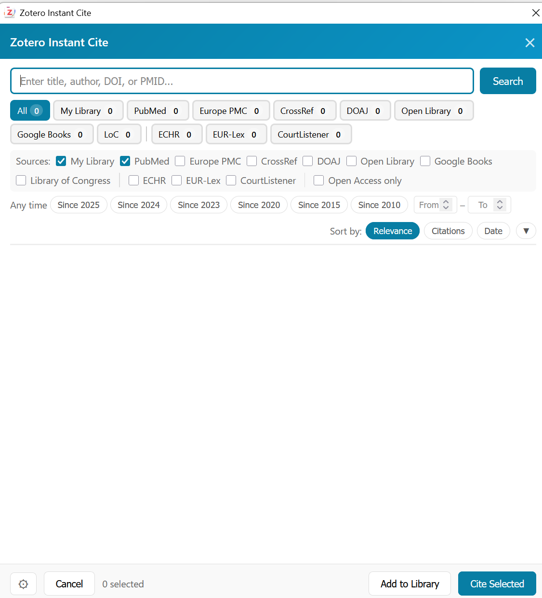

# Instant Cite for WordCraft

Instant Cite for WordCraft brings the Instant Cite search, add and cite dialog to the
[WordCraft](https://wordcraft.app) word processor. When you choose **Add/Edit Citation** in
WordCraft, the plugin opens Instant Cite instead of Zotero's citation dialog, so you can
search your library and online sources, add a paper to Zotero and cite it in one step.



## What it does

- Searches by title, author, keyword, DOI, ISBN, or PMID.
- Takes a web link: a DOI, PMID or OpenAlex ID in the link is looked up directly; otherwise Zotero's own translators read the page, as the Zotero Connector would, and the reference is saved with every field they fill.
- Advanced search narrows a query by title, author, DOI or ISBN, document type, and year or year range.
- Queries your Zotero library and the academic, bibliographic, or legal sources you enable.
- Orders results by relevance and checks them against items already in your library and document.
- Shows authors, publication, year, DOI, and abstract before you cite.
- Can locate an open-access PDF when one is available.
- Inserts citations in WordCraft and keeps the bibliography linked to Zotero.
- Gives WordCraft's Zotero Add/Edit Citation a keyboard shortcut (default Ctrl+Shift+I, Windows).

## How WordCraft is recognised

WordCraft connects to Zotero through the LibreOffice integration protocol (TCP port 23116), so
Zotero itself sees a LibreOffice session. The plugin looks at the process on the other end of
that connection (`netstat` and `tasklist` on Windows, `lsof` on macOS and Linux) and only
takes over the citation dialog when that process is WordCraft. Citations from Word,
LibreOffice and Google Docs keep Zotero's own dialog, or the original Instant Cite if it is
installed. When the process lookup is inconclusive, the session is treated as WordCraft.

The **Only WordCraft documents** setting turns this check off; the plugin then intercepts
every citation dialog, like the original Instant Cite.

## Search options

Choose the sources and search options in Zotero. An OpenAlex API key is optional; adding a free key from your openalex.org account raises the daily OpenAlex quota.

## Using it next to Instant Cite

The plugin has its own add-on ID, preferences (`extensions.zotero.InstantCiteWordCraft.*`) and
menu entries (**Tools > Instant Cite (WordCraft) - ...**), so it can be installed together with
the original Instant Cite. With both installed:

- Zotero's Ctrl+Shift+I / Alt+Shift+P shortcuts and the item context menu entry stay with the original plugin.
- Whichever plugin Zotero loads last sees the citation request first. If the original
  Instant Cite intercepts WordCraft citations too, both open the same kind of dialog; turn off
  **Intercept citations** in the original plugin if you want it to handle only Word and LibreOffice.

## Keyboard shortcut in WordCraft

Open Instant Cite from Zotero (**Tools > Instant Cite (WordCraft) - Search Papers**), open the
settings and use **WordCraft Integration > Install Shortcut**.

WordCraft 0.10.0 has no keyboard setting for its Zotero commands (they are ribbon buttons only and are
missing from Customize Keyboard), so the shortcut is held by a small helper program instead (Windows only):

- `helper/WordCraftCite.cs`, built into `addon/chrome/content/helper/WordCraftCite.exe` by `helper/build.cmd`
  with the .NET Framework compiler that ships with Windows. Zotero copies it into
  `<profile>/instantcitewc/` and starts it with its own process id; the helper exits with Zotero.
- While a WordCraft window is in the foreground the helper registers the hotkey. On the key it opens the
  Zotero ribbon tab, presses **Add/Edit Citation** through UI Automation and switches back to the tab that
  was open. In every other program the key keeps its usual meaning.
- Log: `<profile>/instantcitewc/wordcraft-helper.log`. `WordCraftCite.exe --probe` lists WordCraft's ribbon
  tabs without pressing anything.
- Versions up to 0.2.3 wrote the key into WordCraft's `ui.json`, which WordCraft loads but never fires. That
  entry is removed (with a `ui.json.instantcitewc.bak` backup) the next time WordCraft is closed while Zotero runs.

## Installation

1. Build the plugin (see below) or take `zotero-instant-cite-wordcraft.xpi` from the project folder.
2. In Zotero, open **Tools > Plugins**.
3. Choose **Install Plugin From File**, select the `.xpi`, and restart Zotero if asked.

Supports Zotero 7 and later, including Zotero 10, on Windows, macOS, and Linux. WordCraft needs its Zotero
integration enabled (the Zotero tab in its ribbon).

## Development

```bash
npm ci
npm test
npm run build
```

`npm run build` writes `zotero-instant-cite-wordcraft.xpi` and a versioned copy to the project root.

## License

[MIT](LICENSE). Derived from Zotero Instant Cite; see [NOTICE.md](NOTICE.md).
